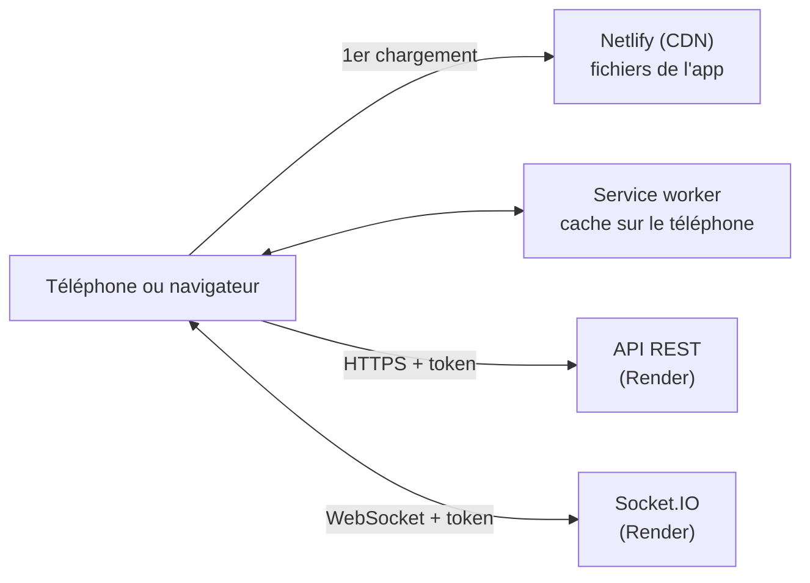
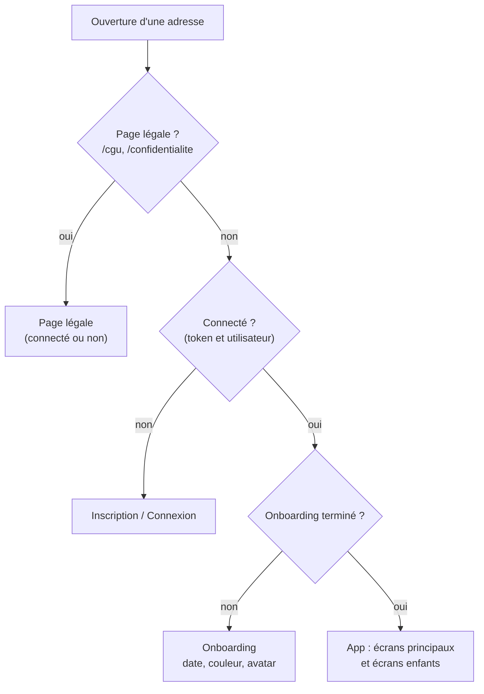
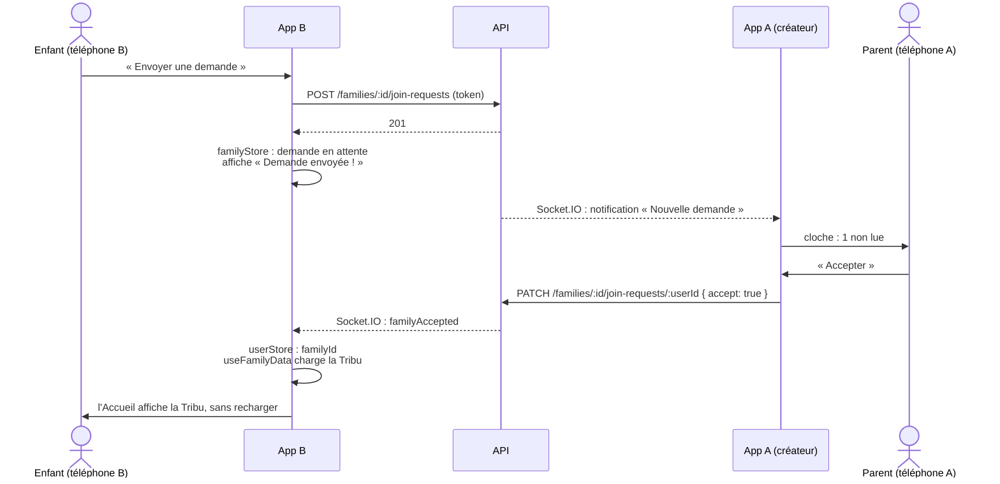

# Architecture - Application Tribu (frontend)

Ce document présente comment l'application Tribu est construite : l'organisation du code, la navigation, la circulation des données, le temps réel et le fonctionnement de la PWA.

La vue d'ensemble du projet (application, API, base de données, services en ligne) est dans le `docs/architecture.md` du backend. Les schémas sont écrits en Mermaid : GitHub les affiche directement.

## 1. Place de l'application dans le projet

L'application est une **PWA** (application web installable) : des fichiers statiques (HTML, JavaScript, CSS, images) servis par Netlify. Elle ne contient aucune règle métier importante (points, badges, droits) : ces règles sont dans l'API, qui reste la seule source de vérité. L'application affiche les données et envoie les actions de l'utilisateur.



| Échange | Comment |
|---|---|
| Fichiers de l'app | Téléchargés une fois depuis Netlify, puis gardés en cache par le service worker |
| Données (Tribu, activités, badges...) | API REST en HTTPS, avec le token de l'utilisateur |
| Événements en direct (chat, notifications, activité lancée...) | Socket.IO, avec le même token |

## 2. Organisation du code

```
src/
├── main.tsx           Point d'entrée : thème, routeur, gestion des erreurs
├── App.tsx            Routes : qui peut voir quel écran
├── api.ts             Tous les appels à l'API (ajoute le token, gère la session expirée)
├── socket.ts          Connexion Socket.IO
├── config.ts          Adresse du backend, adresse de contact, villes
├── screens/           Un fichier par écran (Accueil, Activités, Chat...)
├── components/        Composants réutilisables (Button, Input, ScreenHeader, BadgeCard...)
├── hooks/             Chargement des données et temps réel (useFamilyData, useRealtime...)
├── store/             Données partagées entre écrans (userStore, familyStore)
├── context/           Thème (vert, orange, rouge)
└── assets/            Polices, avatars, illustrations, images des badges
```

Chaque dossier a un rôle précis :

| Couche | Rôle | Exemple |
|---|---|---|
| **Écrans** (`screens/`) | Afficher un écran de la maquette et réagir aux actions de l'utilisateur | `ActivityDetail.tsx` : choisir, terminer ou abandonner une activité |
| **Composants** (`components/`) | Morceaux d'interface utilisés sur plusieurs écrans, sans appel à l'API (sauf exceptions simples) | `Button`, `ConfirmModal`, `BadgeCard` |
| **Hooks** (`hooks/`) | Logique réutilisable : charger des données, écouter le temps réel | `useFamilyBadges` charge les badges d'une Tribu |
| **Stores** (`store/`) | Données partagées entre écrans, mises à jour par les écrans et par le temps réel | `familyStore` : Tribu, activité en cours, messages non lus |
| **Accès au backend** (`api.ts`, `socket.ts`) | Un seul endroit pour parler au serveur | `api('families', { method: 'POST', body })` |

Cette séparation rend le code plus simple à lire et à tester : un écran ne connaît pas l'adresse du serveur, et un composant comme `Button` peut être testé seul.

## 3. Navigation et écrans protégés

L'application est une **application à page unique** : React Router change l'écran affiché sans recharger la page. `App.tsx` choisit les écrans accessibles selon l'état de l'utilisateur :



- Un écran protégé ouvert sans être connecté renvoie vers l'inscription : **la vérification est faite avant d'afficher l'écran**. La vraie protection reste côté API (token vérifié sur chaque route) : l'app ne fait que cacher ce qui ne servirait à rien.
- **Écrans principaux** (Accueil, Récompenses, Activités, Chat, Profil) : avec la barre du bas (`TabsLayout`).
- **Écrans enfants** (détails, recherche, historique...) : avec un bouton retour en haut (`ScreenHeader`), sans barre du bas.
- Toutes les adresses de Netlify renvoient vers `index.html` (`public/_redirects`) : un lien direct vers un écran fonctionne, même après un rechargement.

La liste complète des adresses est dans le README (partie Navigation).

## 4. Circulation des données

### Appels à l'API

Tous les appels passent par la fonction `api()` (`api.ts`) :

1. elle ajoute l'adresse du serveur, le token et le format JSON ;
2. elle renvoie la réponse à l'écran, qui affiche le résultat ou un message d'erreur ;
3. si le serveur répond `401` (token expiré ou invalide), elle déconnecte l'utilisateur et l'envoie vers la connexion.

### Stores

| Store | Contenu | Sauvegarde |
|---|---|---|
| `userStore` | Utilisateur connecté, token, onboarding terminé | Dans le navigateur (`localStorage`) : l'utilisateur reste connecté après une fermeture de l'app |
| `familyStore` | Tribu et membres, activité en cours, historique, messages non lus, demande en attente, notifications | En mémoire seulement : rechargé depuis l'API à chaque ouverture |

Les données de la Tribu sont chargées **une seule fois pour toute l'app** (`useFamilyData`), et non par chaque écran. Les écrans lisent les stores : quand une donnée change, seuls les écrans qui l'utilisent se mettent à jour.

### Exemple : envoyer une demande pour rejoindre une Tribu



Ce parcours est vérifié par un test système avec deux navigateurs en même temps (voir [tests.md](tests.md)).

## 5. Temps réel

`useRealtime` ouvre la connexion Socket.IO quand l'utilisateur est connecté, rejoint la « room » de sa Tribu (le serveur n'envoie les événements qu'aux membres) et met à jour les stores à chaque événement : nouveau message, notification, Tribu modifiée, nouveau membre, activité lancée ou terminée, demande acceptée ou refusée. La liste des événements est dans le README (partie Temps réel).

Sur téléphone, la connexion peut être coupée (app en arrière-plan, réseau faible). Deux mécanismes rattrapent ce qui s'est passé pendant la coupure :

- **reconnexion automatique** de Socket.IO, puis nouvelle demande des données (profil, messages non lus, notifications) ;
- **retour sur l'app** (PWA de nouveau au premier plan) : mêmes données relues.

## 6. PWA et fonctionnement hors ligne

| Élément | Rôle |
|---|---|
| **Manifeste** (`vite.config.ts`) | Nom, icônes, couleurs, affichage plein écran : permet l'installation sur l'écran d'accueil |
| **Service worker** (généré par `vite-plugin-pwa`) | Garde en cache les fichiers de l'app (écrans, polices, images) : l'app s'ouvre même sans réseau, et ne retélécharge pas ses fichiers à chaque ouverture |
| **Mise à jour automatique** | À chaque lancement, le service worker vérifie s'il existe une nouvelle version et la récupère |

Les appels à l'API ne sont pas mis en cache : les données de la Tribu sont toujours celles du serveur. Sans réseau, l'app s'ouvre, mais les données ne peuvent pas être chargées : une action affiche alors « Impossible de se connecter au serveur. ».

## 7. Gestion des erreurs

| Situation | Comportement |
|---|---|
| Erreur renvoyée par l'API (ex : email déjà utilisé) | Message en français affiché sur l'écran (texte fourni par l'API ou par l'écran) |
| Serveur injoignable | « Impossible de se connecter au serveur. » |
| Session expirée | Déconnexion et retour à la connexion |
| Écran qui plante (erreur imprévue) | `ErrorBoundary` affiche un message avec un bouton « Recharger », au lieu d'une page blanche |
| Activité supprimée du catalogue | Ignorée dans les stores, pour que les écrans ne plantent pas |

## 8. Évolutivité

### Ajouter des fonctionnalités

L'organisation en couches permet d'ajouter un écran sans toucher aux autres : un fichier dans `screens/`, une route dans `App.tsx`, et la réutilisation des composants, des stores et de `api()`. La marche à suivre est décrite dans le README (partie « Ajouter un écran »).

Exemples d'évolutions prévues et leur impact :

| Évolution | Ce qu'il faut ajouter |
|---|---|
| Supprimer son compte | Un bouton dans le Profil, un appel à l'API, puis `logoutSession()` |
| Notifications push | Un abonnement dans le service worker, et l'envoi côté backend |
| Application mobile native | Les écrans peuvent être emballés avec Capacitor, ou repris en React Native (mêmes notions : composants, hooks) |

### Supporter plus d'utilisateurs

L'application est un ensemble de fichiers statiques servis par un CDN : **le nombre d'utilisateurs n'a presque pas d'effet sur elle**. La charge est portée par l'API (voir le `docs/performance.md` du backend). L'application limite cette charge :

- données de la Tribu chargées une seule fois, puis mises à jour par le temps réel ;
- pas de requêtes répétées pour savoir s'il y a du nouveau ;
- catalogue d'activités gardé en mémoire entre l'Accueil et l'onglet Activités.

### Points à surveiller

- **Poids de l'application** : tout le code est dans un seul fichier JavaScript (environ 130 Ko compressé). Si l'app grossit beaucoup, les écrans pourront être chargés seulement quand on les ouvre (*lazy loading*).
- **Taille des stores** : `familyStore` regroupe beaucoup de données. S'il grossit, il pourra être découpé (activités, notifications, chat).
